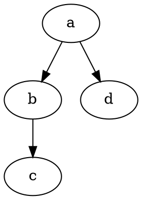

# DOT Diagrams

DOT Diagrams draws Graphviz DOT code blocks as diagrams inside your notes. It draws offline with bundled Graphviz WebAssembly, so it needs no server or Graphviz install, and graphs stay on your device.

It works in reading view and Live Preview, and the colors follow your theme.


Free: offline DOT diagrams, theme colors, line errors. Pro: links between diagram nodes and notes. $15 one time or $5 a month: [Sponsor](https://github.com/sponsors/theluckystrike?frequency=one-time&metadata_source=dot-diagrams) or [$15 one-time offer](https://github.com/sponsors/theluckystrike/sponsorships?tier_id=666162&metadata_source=dot-diagrams).

## Quick start

Paste this into a note:

~~~markdown

~~~

Switch to reading view, or move the cursor out of the block in Live Preview. The first diagram must wait for the engine.

## Features

### Diagrams in the note

A `dot` or `graphviz` block draws as an SVG, and draws again when you edit it. In Live Preview the block shows the diagram until you move the cursor into it. Buttons appear on hover. "Copy" puts the SVG on the clipboard, light on white.


### Colors that follow your theme

Diagrams use the text, line and fill colors of your theme on a transparent background, and draw again when you change the theme. Colors that you set in the DOT source, such as `color=red`, win.


### Error messages with the line number

When Graphviz cannot read the block, DOT Diagrams draws nothing and shows a red box with the line number, the message and the text of that line. The number matches your block.

 ;" width="720">

### Three layout engines

The default engine is `dot`, which draws layers. A comment on its own line picks another: `// engine: neato` draws a spring layout and `// engine: circo` draws a circle layout. Both are free.


### Diagrams from a DOT file

Name a `.dot` or `.gv` vault file in a block to draw it. It draws again when the file changes. It is free.

```dot
// file: graphs/build.dot
```

The path starts at the vault root. A bare name or `[[build.dot]]` finds the file like a link. Put only comment lines in that block. Its option lines win over the file's own. A block with its own graph ignores the line. An error names the file and line.


### Width and alignment

A wide graph shrinks to the note width. A comment line sets the size and place of one diagram:

- `// width: natural` keeps the Graphviz size. A wider diagram scrolls in the block.
- `// width: 60%` (10% to 100%) or `// width: 480px` (50px to 4000px) sets the width. The height follows.
- `// align: left`, `center` or `right` moves the diagram.

A `// file:` block also reads these lines from the file. Copy and export keep the natural size.


### Notes that open from nodes (Pro)

With Pro, select a wikilink node to open its note. Hold Ctrl (Cmd on macOS) for a new tab. Three forms work: a quoted node id such as `"[[Notes/Plan|Plan]]"`, `URL="[[Architecture]]"`, and a label such as `label="Read [[Syntax error]]"`. The node shows the note name or alias and gets the graph's `node [...]` defaults. A label or URL that you set wins. Without Pro, the nodes show the name as plain text.


### Export to SVG and PNG (Pro)

With Pro, the export buttons or the two "Export the diagram at the cursor" commands save the diagram in the attachment folder of the note, light on white, with no note links.


### More engines and style presets (Pro)

With Pro, `fdp`, `sfdp`, `twopi` and `osage` also work. A comment such as `// preset: blueprint` styles one block. The presets are `clean`, `blueprint`, `mono`, `pastel` and `contrast`. A preset sets its own colors and ignores the theme.


## Install

1. Open "Settings → Community plugins" and turn off restricted mode.
2. Select "Browse", search for "DOT Diagrams", then "Install" and "Enable".

To install by hand, copy `main.js`, `manifest.json` and `styles.css` from the latest release into `<vault>/.obsidian/plugins/dot-diagrams/`, then enable it. You need Obsidian 1.13.4 or later.

## Usage

1. Write a fenced block in a note and give it the language `dot` or `graphviz`.
2. Write a graph in the DOT language, for example `digraph { a -> b -> c; a -> d }`.
3. Switch to reading view, or move the cursor out of the block in Live Preview.

The first diagram must wait for the engine.

Comment lines on their own lines, anywhere in a block, set options for that block:

- `// engine: neato` chooses the layout engine.
- `// preset: blueprint` chooses a style preset (Pro).
- `// file: graphs/build.dot` draws a .dot or .gv file of the vault.
- `// width: 60%` and `// align: left` set the size and place of the diagram.

`#` and `/* engine: circo */` comments also work. The first line of each kind wins. An unknown value uses the default and shows a message.

## Settings

After a minor or major update, this plugin opens one What's new tab in the background. The tab and settings card suggest other NoteMods plugins and Zovo Chat and link to notemods.com for feedback ([privacy](https://notemods.com/privacy/)). The tab sends no data. Turn the tab off in Settings.

| Setting | What it does |
| --- | --- |
| Default layout engine | The engine for blocks without an `// engine:` line. Default `dot`. fdp, sfdp, twopi and osage need Pro. |
| Default style preset | Pro. The preset for blocks without a `// preset:` line. Empty means the theme colors. |
| Default diagram width | For blocks without a `// width:` line. Fit (default) or natural. |
| Default alignment | For blocks without an `// align:` line. Left, center (default) or right. |
| Show buttons above diagrams | Shows the Copy, Export SVG and Export PNG buttons on hover. On by default. |
| Edge limit | A block with more edges is not drawn. From 50 to 20,000, default 300. |
| PNG export scale | Pro. 1 to 4 times the size at 96 dpi, default 2. |

The settings tab also has the Pro section: sign in, the status line and Refresh.

## FAQ

### Does my graph leave my device?

No. The Graphviz WebAssembly build inside `main.js` draws each diagram on your device with no request. DOT Diagrams also removes `<script>` elements, event handlers, remote images and `javascript:` links from the SVG.

### Can I use `![[graph.dot]]` instead?

Not yet. Obsidian gives plugins no public way to draw that embed in Live Preview. Use a block with a `// file:` line.

### Why not use Mermaid?

Mermaid is a different language. Use DOT Diagrams for DOT, such as a call graph from another tool.

### How is this different from the Kroki plugin?

The Kroki plugin sends your block to a Kroki server, so it needs a network or your own server. DOT Diagrams draws locally.

### How big is the plugin, and how fast is it?

`main.js` is about 0.87 MB, mostly the Graphviz engine. Layout runs on the main thread and its cost grows fast with tangled graphs, so a block over the edge limit (default 300) is not drawn. Copy and export use the same limit. The text limit is 300,000 characters.

### Is the code readable?

`main.js` is one minified file, like most plugins. The engine is the Apache-2.0 library @hpcc-js/wasm-graphviz 1.29.1, with its unused network code removed. `THIRD-PARTY.md` lists the licenses and the changes.

## Payment, account and network

The core features are free. Pro features need a GitHub Sponsors sponsorship of theluckystrike: $5 a month or more, or $15 once. A total payment of $15 meets the payment requirement for Pro without further payment. Sign-in and the checks below still apply. Your notes stay readable and editable with or without Pro.

GitHub handles the payment. Sponsor at https://github.com/sponsors/theluckystrike?frequency=one-time&metadata_source=dot-diagrams. You need no account for the free features. Pro needs the GitHub account that sponsors.

Until you select "Sign in with GitHub" in the settings, DOT Diagrams makes no network requests. Sign in uses the GitHub device flow. DOT Diagrams sends its public client ID and the scope `read:user` to `https://github.com/login/device/code` and shows you a code. While you enter the code at https://github.com/login/device, it asks `https://github.com/login/oauth/access_token` every few seconds to check the sign-in status. The scope permits profile reads only. GitHub needs this access to show the sponsorship tier. It grants no repository scope and no write access.

After sign in, DOT Diagrams sends one query to `https://api.github.com/graphql`. It checks if the signed-in account sponsors theluckystrike. It asks for the tier and the total payment to theluckystrike. The plugin reuses a successful check for 7 days. Failed checks can retry after 6 hours. Select Refresh to request an earlier check. It sends no note content, file names or other vault data, and it has no telemetry.

After a successful check, Pro can work offline for up to 14 days. Sign out or a negative sponsorship answer turns Pro off. The plugin stores the GitHub token through the secret storage API of Obsidian. It does not put the token in its saved settings or its local sponsorship data. The local storage of this device keeps your GitHub login, the tier and the time of the last check. Sign out clears the token. You can also revoke the access in your GitHub settings, under Applications.

## Support

Plugin page: [dot-diagrams](https://notemods.com/plugins/dot-diagrams/).

Report bugs or request features in [issues](https://github.com/theluckystrike/dot-diagrams/issues) with your Obsidian version and DOT block.

## Community

Questions, bugs or plugin ideas? Talk to me and other Obsidian users in [Zovo Chat](https://t.me/+k2MM-BIc7SQ5OWM0) on Telegram. It has a topic for these plugins. You can also open an issue here.
