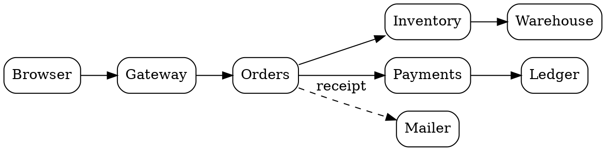

# Order service architecture

The checkout path, from the browser to the ledger. Edit the block and the diagram redraws.

The same graph works in a block that starts with three backticks and the word graphviz.
